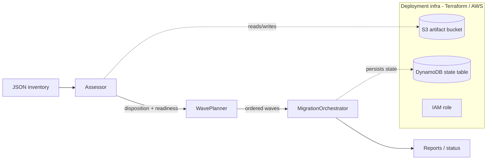

# Cloud Migration Factory

[](LICENSE)
[](https://github.com/abhisheksawant52/cloud-migration-factory/actions/workflows/ci.yml)
[](https://www.python.org/)
[](https://github.com/psf/black)

A pure-Python CLI and library for running a **cloud migration factory** —
discover and assess a server estate, plan dependency-ordered migration waves,
and orchestrate each workload through its migration lifecycle.

## Overview

Migrating a data center to the cloud at scale is a repeatable, factory-style
process: take an inventory, decide *what to do* with each workload (the 6 Rs),
*when* to move it (waves), and *track* it as it moves. This project models that
process as three composable stages behind a single `migration-factory` CLI.

The **assessment** stage ingests a JSON inventory and recommends a disposition
(rehost, replatform, refactor, retire, retain, repurchase) plus a 0-100
readiness score per server. The **wave planner** groups servers into
dependency-ordered waves that respect a maximum wave size, so a database is
never scheduled after the application that depends on it. The **orchestrator**
tracks each workload through a strict state machine as it is migrated.

It is aimed at cloud and platform engineers who want a deterministic,
scriptable core they can wrap with their own discovery tooling and inventory
sources. The logic is pure Python with no cloud SDK calls, so it runs anywhere
and is trivial to test.

## Architecture



Components:

- **Assessor** (`assessment.py`) — applies deterministic rules to recommend a
  disposition and compute a readiness score for each server.
- **WavePlanner** (`wave_planner.py`) — topologically sorts the dependency
  graph and packs servers into size-bounded waves.
- **MigrationOrchestrator** (`orchestrator.py`) — enforces the
  `pending -> replicating -> testing -> cutover -> complete` state machine.
- **CLI** (`cli.py`) — Click entrypoint exposing `assess`, `plan-waves`,
  `status`, and `report`.
- **Deployment infrastructure** (`terraform/`) — an S3 artifact bucket,
  DynamoDB state table, and IAM role that back the factory on AWS.

## Features

- Disposition recommendations across all six Rs with human-readable rationale.
- Readiness scoring that penalizes coupling, end-of-life OSes, and effort.
- Dependency-aware wave planning with a configurable maximum wave size.
- A strict, well-tested migration state machine with an audit trail of notes.
- JSON inventory in, JSON inventory out — easy to pipe between stages.
- Terraform for the factory's own AWS backend (S3 + DynamoDB + IAM).
- Zero cloud dependencies in the core logic; only `click` and `pydantic`.

## Tech Stack

Python 3.11+ · Click · Pydantic v2 · pydantic-settings · pytest · ruff · black ·
Terraform (AWS) · GitHub Actions

## Getting Started

### Prerequisites

- Python 3.11 or newer
- `make` (optional, for convenience targets)
- Terraform 1.5+ (only to deploy the AWS backend)

### Install

```bash
python -m venv .venv && source .venv/bin/activate
make install            # pip install -e ".[dev]"
```

### Run

```bash
# 1. Assess an inventory and write the recommendations back out.
migration-factory assess examples/inventory.json -o assessed.json

# 2. Plan dependency-ordered waves (max 10 servers per wave by default).
migration-factory plan-waves assessed.json --max-wave-size 5 -o planned.json

# 3. Drive tasks through the lifecycle and report status counts.
migration-factory status planned.json --advance-to testing

# 4. Print a combined assessment + wave-plan report.
migration-factory report examples/inventory.json
```

## Project Structure

```
.
├── src/migration_factory/
│   ├── models.py            # Pydantic models: Server/Application/Wave/MigrationTask
│   ├── assessment.py        # Assessor: dispositions + readiness score
│   ├── wave_planner.py      # WavePlanner: dependency-ordered waves
│   ├── orchestrator.py      # MigrationOrchestrator: task state machine
│   ├── config.py            # pydantic-settings configuration
│   ├── logging_config.py    # logging setup (text or JSON)
│   └── cli.py               # Click CLI: assess / plan-waves / status / report
├── terraform/               # AWS backend: S3 + DynamoDB + IAM
│   ├── modules/state-store/ # reusable S3 bucket + DynamoDB table module
│   └── environments/        # dev and prod tfvars + backend configs
├── examples/inventory.json  # sample inventory to try the CLI
├── docs/usage.md            # end-to-end walkthrough
└── tests/                   # pytest suite (assessment, planning, orchestration)
```

## Configuration

Configuration is read from the environment (or a `.env` file) using the
`MIGRATION_FACTORY_` prefix. See [`.env.example`](.env.example).

| Variable                               | Default                       | Description                                         |
| -------------------------------------- | ----------------------------- | --------------------------------------------------- |
| `MIGRATION_FACTORY_LOG_LEVEL`          | `INFO`                        | Logging verbosity.                                  |
| `MIGRATION_FACTORY_LOG_JSON`           | `false`                       | Emit structured JSON logs when true.                |
| `MIGRATION_FACTORY_MAX_WAVE_SIZE`      | `10`                          | Default maximum servers per wave.                   |
| `MIGRATION_FACTORY_IDLE_CPU_THRESHOLD` | `0`                           | vCPU at/below which a server is a retire candidate. |
| `MIGRATION_FACTORY_AWS_REGION`         | `us-east-1`                   | AWS region for the deployment backend.              |
| `MIGRATION_FACTORY_ARTIFACT_BUCKET`    | `migration-factory-artifacts` | S3 bucket for inventory/plan artifacts.             |
| `MIGRATION_FACTORY_STATE_TABLE`        | `migration-factory-state`     | DynamoDB table for migration state.                 |

## Deployment

The factory's AWS backend is defined in [`terraform/`](terraform/). Each
environment has its own tfvars and partial backend config:

```bash
cd terraform
terraform init -backend-config=environments/dev/backend.hcl
terraform plan  -var-file=environments/dev/dev.tfvars
terraform apply -var-file=environments/dev/dev.tfvars
```

This provisions the S3 artifact bucket (versioned, encrypted, public access
blocked), the DynamoDB migration-state table (with point-in-time recovery), and
the IAM role the factory assumes — via the reusable
[`modules/state-store`](terraform/modules/state-store) module.

## Contributing

Contributions are welcome — see [CONTRIBUTING.md](CONTRIBUTING.md) and our
[Code of Conduct](CODE_OF_CONDUCT.md).

## Security

Please report vulnerabilities as described in [SECURITY.md](SECURITY.md).

## License

Released under the [MIT License](LICENSE).
